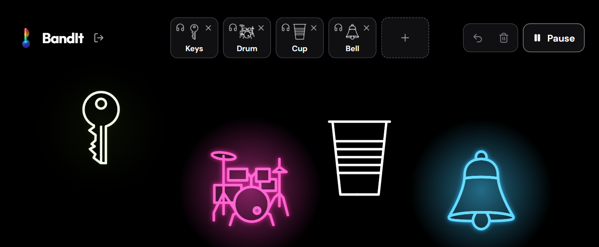

# BandIt

BandIt is a browser music studio where a sketched keyring jingles on the offbeats and a cup taps out the backbeat.



[Play BandIt](https://www.bandit.select/?demo)

## Features

- Sketch in white ink with a mouse, finger, or pen, then pick a matching illustration.
- Shake your phone to hear a lone drawing play each time it hits an edge.
- Add a second instrument to start a four-bar groove at 96 BPM.
- Fill a **+** slot with a photo, a saved drawing, or a beatbox voice like **Lip Kick**.
- Tap the headphones to solo a part, or hold them for a quick listen.

## Quick start

Use Node.js with built-in TypeScript support and npm.

```sh
npm ci
npm run dev
```

Choose **See demo** at the local URL Vite prints.
Draw a key, then choose **Keys**.
Repeat with a drum, cup, and bell to play Tabletop Bingo without API keys.

## Docs

- [How sketches and photos become instruments](docs/recognition.md)
- [The four-bar score and phone motion](docs/playback.md)
- [Where the sounds come from](docs/sounds.md)
- [Saved mixes, sign-in, and API keys](docs/authentication.md)
